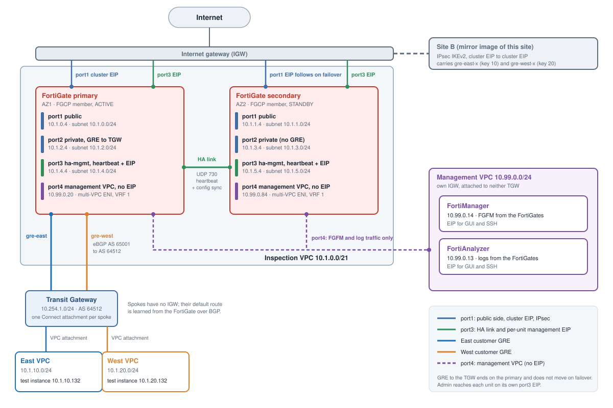

## Topology

Each site has:

- an **inspection VPC** with a FortiGate FGCP A-P pair (primary in AZ1, secondary in AZ2)
- a **Transit Gateway** with an **east** and a **west** spoke VPC attached
- a test Linux instance in each spoke (optional)

The two sites are joined by one IPsec tunnel between the **cluster EIPs**. A shared **management VPC** (not attached to either
TGW) holds FortiManager and FortiAnalyzer, and every FortiGate has a port4 interface in it (no EIP). Each FortiGate has an
EIP on port3 (HA management and heartbeat) for admin access.

## Traffic flows

| Flow | Path |
|---|---|
| Spoke to internet | spoke VPC → TGW → Connect (GRE) → primary FortiGate → port1 (NAT to the cluster EIP) |
| Spoke to the same customer's spoke at the other site | spoke → TGW → GRE → FortiGate → `gre-<customer>-x` → IPsec → other site's FortiGate → GRE → TGW → spoke |
| East to west | blocked by policy and logged (`deny-east-west`) |
| Admin SSH to a spoke instance | admin → cluster EIP:port (VIP) → port1 → `gre-<customer>` → TGW → spoke |
| Management | admin → the unit's port3 EIP (GUI/SSH, limited to `management_cidr_sg`); FortiGate → EC2 API out port3; FortiGate ↔ FortiManager (FGFM) and FortiGate → FortiAnalyzer (logs) over port4 in the management VPC |

## Addressing

Defaults from `terraform/terraform.tfvars.example`:

| Item | Site A | Site B |
|---|---|---|
| Inspection VPC | 10.1.0.0/21 | 10.2.0.0/21 |
| East spoke | 10.1.10.0/24 | 10.2.10.0/24 |
| West spoke | 10.1.20.0/24 | 10.2.20.0/24 |
| TGW GRE address block | 10.254.1.0/24 | 10.254.2.0/24 |
| Management VPC | 10.99.0.0/24 (shared) | |

The inspection /21 is split into eight /24 subnets: public (AZ1, AZ2), private, ha-mgmt and tgw. Each spoke /24 is split
into four /26 subnets. Pinned FortiGate addresses make the lab predictable:

| Unit | port1 | port2 | port3 | port4 |
|---|---|---|---|---|
| Site A primary | 10.1.0.4 | 10.1.2.4 | 10.1.4.4 | 10.99.0.20 |
| Site A secondary | 10.1.1.4 | 10.1.3.4 | 10.1.5.4 | 10.99.0.84 |

The GRE and tunnel address plan:

| Tunnel | Underlay | Inside addresses |
|---|---|---|
| `gre-east` (to TGW) | port2 ↔ 10.254.x.10 | 169.254.6.0/29: FortiGate .1, TGW BGP peers .2 and .3 |
| `gre-west` (to TGW) | port2 ↔ 10.254.x.11 | 169.254.7.0/29: FortiGate .1, TGW BGP peers .2 and .3 |
| IPsec tunnel interface | cluster EIP ↔ cluster EIP | 169.254.100.0/30: site A .1, site B .2 |
| `gre-east-x` (key 10) | 169.254.100.1 ↔ .2 | 169.254.10.0/30: site A .1, site B .2 |
| `gre-west-x` (key 20) | 169.254.100.1 ↔ .2 | 169.254.20.0/30: site A .1, site B .2 |

## Design principles

1. **One shared pair of firewalls per site.** The customers are not given their own FortiGates.
2. **One tunnel per customer per hop.** East never shares a tunnel with west.
3. **Policy is the boundary.** Every policy names one customer's interfaces and addresses, and the last one denies the crossing.
4. **Unrouted by accident is not isolation.** The TGW route tables, the BGP prefix-lists and the policies each separate the customers independently.
