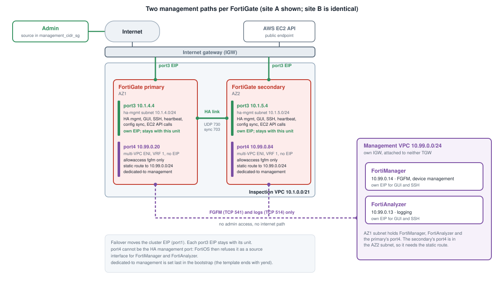

## Overview

Each FortiGate has two management-related interfaces with different jobs:

| Interface | Where | EIP | Used for |
|---|---|---|---|
| **port3** | inspection VPC, public ha-mgmt subnet | **yes** (one per unit) | heartbeat, config sync, the **HA management interface**, GUI and SSH, and the EC2 API calls that fail over AWS |
| **port4** | management VPC (multi-VPC ENI) | **no** | FortiManager (FGFM) and FortiAnalyzer logging only |



## Port3: HA management

Port3 follows the FGCP reference ([FGCP in AWS](https://fortinetcloudcse.github.io/FGCP-in-AWS/)): on FortiOS 7.0 and newer one
ENI carries both HA management and the HA communication channels, and it sits in a public subnet with an EIP so each unit has
its own address and its own path to the public EC2 API.

```
config system ha
    set ha-mgmt-status enable
    config ha-mgmt-interface
        edit 1
            set interface port3
            set gateway <this unit's ha-mgmt subnet gateway>
        next
    end
    set hbdev port3 50
end
config system interface
    edit port3
        set ip <pinned port3 address> <mask>
        set allowaccess ping https ssh
    next
end
```

Each unit uses the gateway of its **own** subnet.

**Security group on port3**
- TCP 443, TCP 22 and ICMP from `management_cidr_sg` only
- all traffic from the inspection VPC CIDR (heartbeat and config sync)

**What failover moves.** On failover FortiOS moves the EIPs to the new primary and updates the routes that point at the old
primary's ENI. The cluster EIP (on port1's primary IP) moves that way. Port3's EIP does not: port3 is the HA management interface
(`ha-mgmt-interface` in `config system ha`), so its EIP belongs to each unit and stays put. An EIP on any other ENI, including a
dedicated management ENI such as port4, would move with the primary. That is why the per-unit EIP lives on port3 and port4 has none.

## Port4: FortiManager and FortiAnalyzer only

Port4 is a multi-VPC ENI: it lives in a subnet of the management VPC and is attached to an instance in the inspection VPC.

```
config system interface
    edit port4
        set mode static
        set vrf 1
        set ip <pinned port4 address> <mask>
        set allowaccess fgfm
        set alias management
    next
end
config router static
    edit 2
        set dst <management VPC CIDR>
        set gateway <port4 subnet gateway>
        set device port4
        set vrf 1
    next
end
config system central-management
    set type fortimanager
    set fmg <FortiManager address>
    set interface-select-method specify
    set interface port4
    set vrf-select 1
end
config log fortianalyzer setting
    set status enable
    set server <FortiAnalyzer address>
    set interface-select-method specify
    set interface port4
    set vrf-select 1
end
```

The last stanza of the bootstrap makes port4 `dedicated-to management` (below).

- **No EIP, no admin access.** Only `fgfm` is allowed on the interface: no HTTPS, SSH or ping. The security group on the ENI
  allows TCP 541 from the management VPC CIDR only.
- **VRF 1.** Port4 and its route live in VRF 1, separate from the data plane. The FortiGate generates and receives this traffic
  itself, so no flow crosses between VRFs (the case that needs `skip-vrf-match` for the customer traffic, see [VRF Isolation](../../6_vrf_isolation/)).
- **A route is needed on the secondary.** FortiManager is in the AZ1 management subnet, so the secondary's port4 (AZ2 subnet)
  has no connected network to it. The static route covers both.
- **FortiGuard.** No interface is selected for FortiGuard: port4 has no internet path, and the units validate their PAYG license
  with the defaults.

{}
**`dedicated-to management` must be the last thing in the bootstrap.** FortiOS prompts to reboot when it is set, which aborts
the init script, so nothing after it would run. The template ends with the port4 stanza and a `yend` line that answers the
prompt and ends the stanza.
{}

{}
Port4 cannot be the HA management interface. When it was, FortiOS did not list it as a selectable source interface for
FortiGuard, FortiManager or FortiAnalyzer (`set interface port4` failed with `entry not found in datasource`), the settings were
discarded, and the FortiGate looked for the management VPC through its default route out port1. That is why the HA management
role is on port3 and port4 is an ordinary interface in VRF 1.
{}

For the reasoning behind this split, and what failed before it, see [What We Learned](../../9_what_we_learned/).

## The management VPC

- Its own IGW; it is **not** attached to either TGW
- FortiManager (10.99.0.14) and FortiAnalyzer (10.99.0.13), pinned by `fortimanager_host_ip` and `fortianalyzer_host_ip`
- The four FortiGate port4 ENIs, pinned by `fortigate_mgmt_host_ips` (site A: host 20 of each AZ subnet, site B: host 21)
- Security groups for FortiManager and FortiAnalyzer open to `management_cidr_sg` for the GUI and SSH, and to the management VPC
  CIDR for FGFM (TCP 541) and logging (TCP 514)

## Reaching the units

`terraform output` lists the port3 EIP of each FortiGate. The GUI and SSH answer on those addresses from `management_cidr_sg`.
A SASE tunnel on the admin's laptop changes the source address, which the security group then drops.
FortiManager can add a device by its port4 address (`fgfm` on TCP 541), for example `10.99.0.20`.
