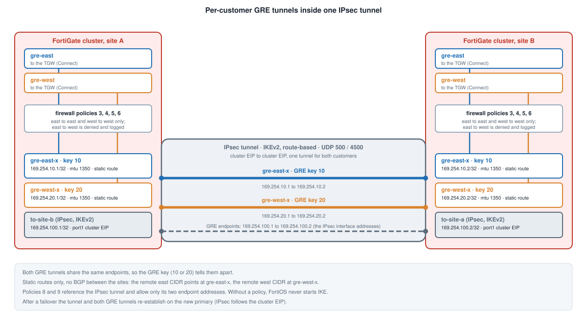

## Overview

The two sites are joined by **one IPsec tunnel** between the cluster EIPs. Inside that tunnel runs **one GRE tunnel per
customer**: `gre-east-x` (GRE key 10) and `gre-west-x` (GRE key 20). East traffic to the other site only ever uses
`gre-east-x`. West traffic only ever uses `gre-west-x`.



## Why a tunnel per customer?

A single shared IPsec tunnel, as the first version of the demo used, carries both customers in one routing and policy
domain. Giving each customer its own GRE tunnel means:

- each customer has its own interface to name in policies, so the policy table shows who is allowed to talk to whom
- each customer has its own routes (the remote east CIDR points only at `gre-east-x`)
- a packet cannot reach the other customer's tunnel without a routing change

## Addressing

| Layer | Site A | Site B |
|---|---|---|
| IPsec interface (`to-site-b` / `to-site-a`) | 169.254.100.1/32, remote .2 | 169.254.100.2/32, remote .1 |
| `gre-east-x` | 169.254.10.1, remote 169.254.10.2 | 169.254.10.2, remote 169.254.10.1 |
| `gre-west-x` | 169.254.20.1, remote 169.254.20.2 | 169.254.20.2, remote 169.254.20.1 |

A `site_index` module variable (1 for site A, 2 for site B) picks the first or second host of every /30. The two GRE tunnels
share the same endpoints, so a **GRE key** tells them apart.

## FortiGate configuration

```
config system interface
    edit to-site-b
        set ip 169.254.100.1 255.255.255.255
        set remote-ip 169.254.100.2 255.255.255.255
    next
end
config system gre-tunnel
    edit gre-east-x
        set interface to-site-b
        set local-gw 169.254.100.1
        set remote-gw 169.254.100.2
        set key-outbound 10
        set key-inbound 10
    next
end
config system interface
    edit gre-east-x
        set ip 169.254.10.1 255.255.255.255
        set remote-ip 169.254.10.2 255.255.255.252
        set mtu-override enable
        set mtu 1350
    next
end
config router static
    edit 20
        set dst <remote east spoke CIDR>
        set device gre-east-x
    next
end
```

The static routes come **after** the interfaces in the bootstrap file, because FortiOS rejects a route that names a device
that does not exist yet. There is no BGP between the sites.

## Why two small policies exist

FortiOS will not negotiate a route-based IPsec tunnel unless a firewall policy references the tunnel interface. The GRE tunnels
are originated by the FortiGate itself and never pass through policy, so on their own they leave the tunnel unreferenced. The
IKE debug then says `ignoring request to establish IPsec SA, no policy configured`, no IKE packet is sent, and every
`gre-*-x` interface sits at zero. Policies 8 and 9 (`ipsec-tunnel-out`, `ipsec-tunnel-in`) reference the tunnel and match only
the two tunnel endpoint addresses, so they allow nothing else.

## MTU

IPsec reduces the usable MTU to about 1400 and the GRE header takes another 24 bytes, so `gre-east-x` and `gre-west-x`
are set to 1350. Check TCP MSS if large transfers stall.

{}
**Unverified on a unit.** This layer is new. Three things in particular were written from the FortiOS CLI as remembered, not
tested: the `key-inbound` / `key-outbound` options on `gre-tunnel`, the `/32` address on the IPsec tunnel interface, and the
1350 MTU. If the CLI rejects a line, the bootstrap stops there; read the console log of the instance.
{}

## HA

The GRE endpoints are the IPsec tunnel addresses, which are the same on both units, so the secondary has the same
configuration. IPsec follows the cluster EIP, so after a failover the tunnel and the inter-site GRE tunnels re-establish on
the new primary.

## Verify

```
diagnose vpn ike gateway list
get router info routing-table all | grep gre-
execute ping 169.254.10.2
execute ping 169.254.20.2
diagnose netlink interface list gre-east-x
```

## The tunnel is in the customer's VRF

`gre-east-x` is in VRF 10 and `gre-west-x` in VRF 20, the same VRFs as the customer's tunnel to the TGW. The IPsec interface itself stays in the
default VRF, so each customer VRF has a static route to the remote tunnel address through it. Same-customer traffic across the sites stays
inside one VRF, so it does not need `skip-vrf-match`. See [Customer Isolation](../3_5_customer_isolation/).
