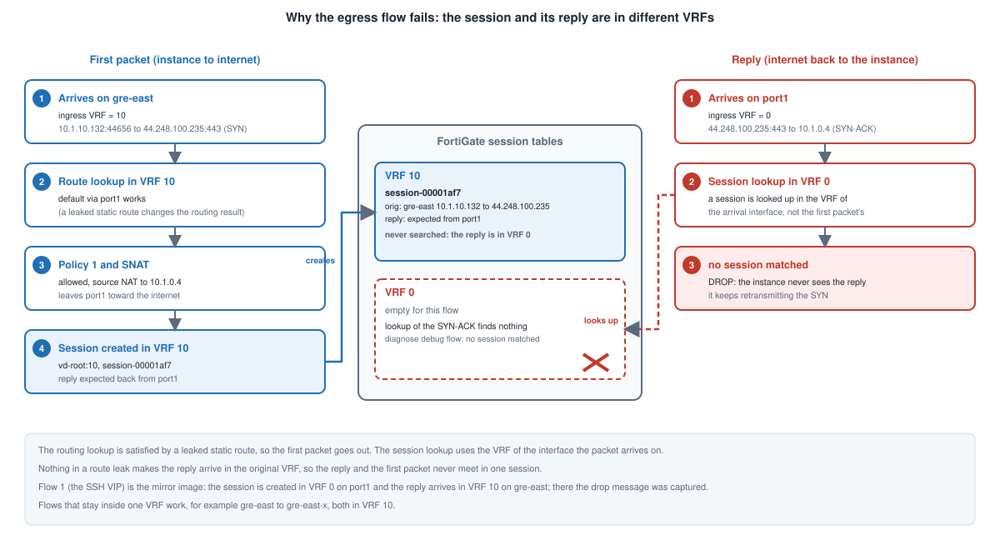

Most of the design stays inside one VRF. Two flows do not, and they are the reason the routes in [Building It](../6_2_building_it/)
and `skip-vrf-match` exist.

## The two flows

**Internet egress.** A spoke's packet arrives on `gre-east` (VRF 10), is translated, and leaves through port1 (VRF 0). The reply
arrives on port1.

```
instance ──SYN──► gre-east (VRF 10) ──SNAT──► port1 (VRF 0) ──► internet
instance ◄──────── gre-east ◄───────────────── port1 ◄────────── SYN-ACK
```

**The SSH VIP.** An administrator's packet arrives on port1 (VRF 0), is translated to the spoke instance, and leaves through
`gre-east` (VRF 10). The reply arrives on `gre-east`.

```
admin ──SYN──► port1 (VRF 0) ──DNAT──► gre-east (VRF 10) ──► instance
admin ◄──────── port1 ◄──────────────── gre-east ◄─────────── SYN-ACK
```

In both, the **first packet and its reply arrive in different VRFs**.

## Two lookups

| Lookup | What it does | Solved by |
|---|---|---|
| Route lookup | finds the exit interface for a packet | the leaked static routes (60 and 70 in [Building It](../6_2_building_it/)); they appear as `S D` in the routing table |
| Session lookup | matches a packet to an existing session | `skip-vrf-match` on the policy |

A packet's VRF comes from the interface it arrives on, and a session is created in that VRF. By default a reply is looked up in
the VRF of **its** arrival interface. In both flows that is the other VRF, so the session is not found and the reply is dropped
with `no session matched`. A leaked route cannot change this, because it changes what the routing table returns, not which VRF the
packet is in.



## What skip-vrf-match does

`set skip-vrf-match enable` on a firewall policy makes the FortiGate ignore the VRF when it matches the reply direction of a session
that policy created. The reply then finds the session in the other VRF, is translated back and is forwarded.

It goes on the policies whose flows cross between a customer VRF and port1:

| Policies | Flow | Set it? |
|---|---|---|
| 1, 2 | internet egress | yes |
| 10 and up | SSH VIPs | yes |
| 3 to 6 | same customer across the sites | no, the flow stays in one VRF |
| 8, 9 | the IPsec tunnel bring-up | no |

Setting it only where a flow needs it keeps the customer VRFs separate everywhere else.

## What it looks like when it works

The session table marks a session created with the option, and the flow debug shows the reply finding it.

**VIP.** The session carries `skip_vrf`, and the forward direction (`gwy=169.254.6.2`) and the reply (`10.1.0.1`) use different interfaces:

```
session info: proto=6 ... refresh_dir=both skip_vrf ...
orgin->sink: org pre->post, reply pre->post dev=3->15/15->3 gwy=169.254.6.2/10.1.0.1
hook=pre  dir=org   act=dnat x.x.x.x:49936->10.1.0.4:2222(10.1.10.132:22)
hook=post dir=reply act=snat 10.1.10.132:22->x.x.x.x:49936(10.1.0.4:2222)
misc=0 policy_id=10 ... vd=0
```

**Egress.** The spoke's packet is created in VRF 10, and the reply arrives in VRF 0 and matches:

```
vd-root:10 received a packet(proto=6, 10.1.10.132:55926->44.254.14.214:443) ... from gre-east
Allowed by Policy-1: SNAT
SNAT 10.1.10.132->10.1.0.4:55926
vd-root:0 received a packet(proto=6, 44.254.14.214:443->10.1.0.4:55926) ... from port1
Find an existing session, id-000004e4, reply direction
DNAT 10.1.0.4:55926->10.1.10.132:55926
```

`Find an existing session ... reply direction` on a packet that arrived in a different VRF (`vd-root:0`) is the setting doing its job.
[Verify and Troubleshoot](../6_4_verify_and_troubleshoot/) shows how to read each line, and what it looks like if the setting is missing.

## Scope

Tested on FortiOS 8.0.1 build 0245 only. Failover, and other FortiOS builds, were not tested.
