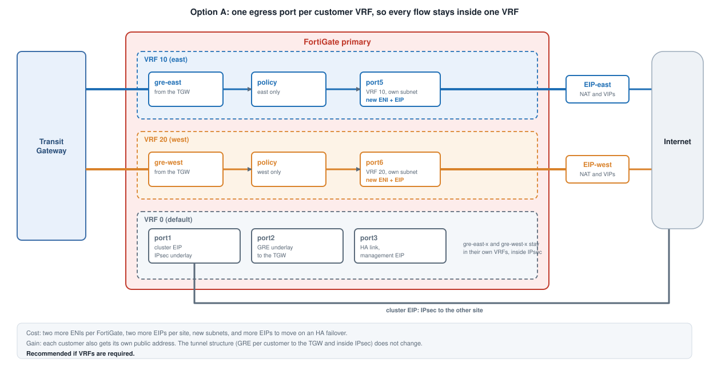

## What the current design does

Each customer has its own VRF, its own tunnels, its own BGP prefix-list, its own TGW route tables and its own firewall policy.
Internet egress and the SSH VIPs work because `skip-vrf-match` lets the reply find its session across the VRF boundary. See
[Customer Isolation](../../3_solution_components/3_5_customer_isolation/) for the configuration and
[Cross-VRF Traffic](../6_3_cross_vrf_traffic/) for why the setting is needed.

## What it does not give you

- **Shared egress.** Both customers leave through port1 and the same cluster EIP, NATed to the same address. The VRFs separate
  routing and sessions on the way in, not the public address.
- **Shared firewall.** The same two FortiGates, CPU and policy table.
- **A cross-VRF exception.** `skip-vrf-match` is the one place where a policy is allowed to cross the VRF boundary. Only apply it
  to the policies that need to reach port1, and review each one. It is not a general setting.

## If a customer needs more separation than this

If `skip-vrf-match` is not acceptable, or a customer needs its own public address, any fix has to give each customer VRF its own
way to the internet that does not cross VRFs.

| Option | How it works | Cost |
|---|---|---|
| **A. A port per customer** | Add port5 (VRF 10) and port6 (VRF 20), each with its own subnet and EIP. NAT and VIPs for a customer use its own port. Every flow then stays inside one VRF. | Two more ENIs per FortiGate, two more EIPs per site, new subnets, and more EIPs to move on an HA failover |
| **B. A VDOM per customer** | Each customer is a separate VDOM with its own interfaces and policy. | Changes HA, FortiManager registration and the whole bootstrap template. Strongest isolation. |
| **C. No internet through the firewall** | Keep the VRFs and the per-customer tunnels, give the spokes SSM VPC endpoints for access and drop the VIPs. | The spokes lose general internet egress |

**Recommendation if a customer needs its own public address:** option A. The tunnel structure stays the same, and each
customer gets an egress address of its own.

## Overlapping address space

The demo uses non-overlapping customer CIDRs. VRFs make overlapping ranges possible in principle, since each VRF has its own
table, but this was **not tested**. The BGP prefixes, the TGW route tables and the `skip-vrf-match` return routes all assume
distinct ranges, so overlapping customers would need those redesigned.
