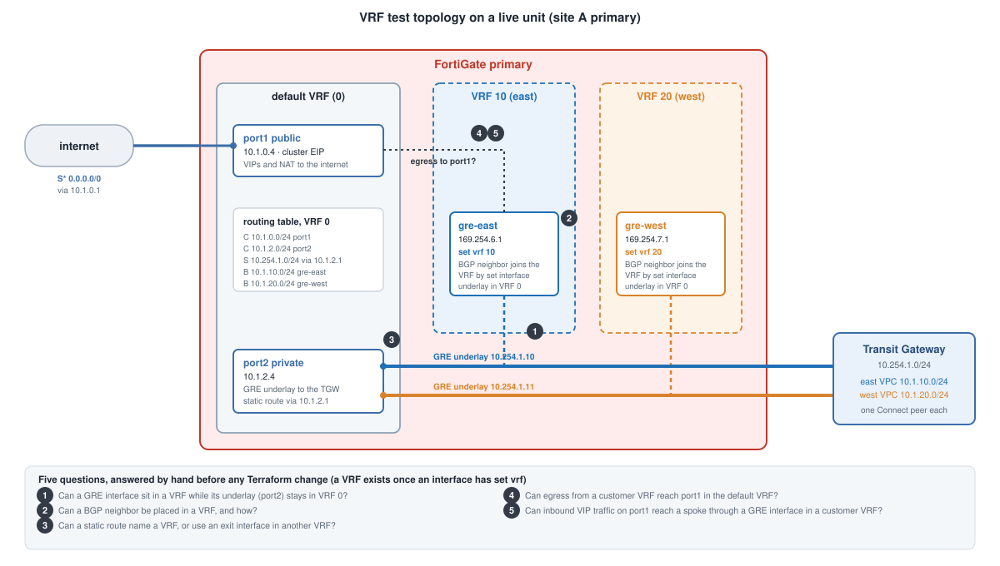

## Goal

Isolate customer traffic on a shared FortiGate pair. Map **east to VRF 10** and **west to VRF 20**:

- `gre-east` and `gre-west` (the TGW tunnels) each in their VRF
- `gre-east-x` and `gre-west-x` (the tunnels through IPsec to the other site) in the same VRF
- a customer's routes, sessions and policies never meet another customer's

The idea was a variable in `terraform/terraform.tfvars`, `customer_vrfs = { east = 10, west = 20 }`, feeding the bootstrap template.
It was never written into the Terraform. The commands below were entered by hand on a live unit first.

## Why test by hand first

A template change replaces all four FortiGates, and several FortiOS behaviors were not known. Five questions needed
answers before any code was written:

1. Can a GRE interface sit in a VRF while its underlay (port2) stays in the default VRF?
2. Can a BGP neighbor be placed in a VRF, and how?
3. Can a static route name a VRF, and can it use an exit interface in another VRF?
4. Can internet egress from a customer VRF reach port1 in the default VRF?
5. Can inbound VIP traffic on port1 reach a spoke through a GRE interface in a customer VRF?

## Starting state

The table below is representative of the starting state, not a captured excerpt.

```
Routing table for VRF=default(0)
S*  0.0.0.0/0      via 10.1.0.1, port1
C   10.1.0.0/24    is directly connected, port1
C   10.1.2.0/24    is directly connected, port2
S   10.254.1.0/24  via 10.1.2.1, port2          (the TGW GRE underlay)
B   10.1.10.0/24   via 169.254.6.x, gre-east    (east spoke, learned by BGP)
B   10.1.20.0/24   via 169.254.7.x, gre-west    (west spoke, learned by BGP)
```

All interfaces were in the default VRF (0). There is no VRF object in FortiOS: a VRF exists once an interface has
`set vrf <n>`.


