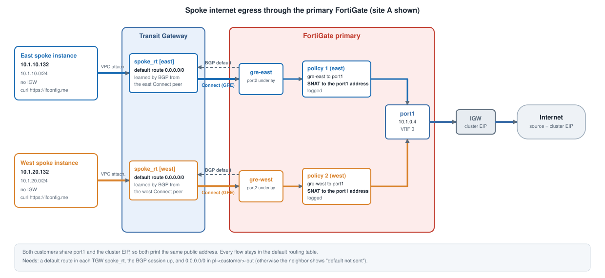

## Spokes reach the internet through the primary FortiGate

The FortiGate advertises a **default route** to the TGW over BGP. The spoke VPC's TGW route table learns it, so spoke traffic
goes TGW → Connect → FortiGate. Policy 1 (east) and policy 2 (west) accept it and NAT it to port1.



## Test

From the east instance (SSM session manager, or SSH through the VIP):

```
curl -s -m 5 https://ifconfig.me          # should print the site A cluster EIP
```

Do the same from the west instance. Both print the same address because both customers share port1 and the cluster EIP.

On the FortiGate:

```
diagnose sniffer packet any 'host <instance IP>' 4 20 l
get router info bgp neighbors 169.254.6.2 advertised-routes
```

## If it fails

| Symptom | Check |
|---|---|
| No traffic reaches the firewall | the TGW `spoke_rt` has a default route; the BGP session is up; `default route is in `pl-<customer>-out` (`get router info bgp neighbors <peer>` must not say "default not sent") |
| Traffic arrives on `gre-east` but never leaves port1 | policy 1 and the route to port1 |
| SYN leaves and SYN-ACK returns but the instance never connects | the reply path; check `skip-vrf-match` on policy 1. This is the failure signature of a missing setting, see [The Failure and the Fix](../../6_vrf_isolation/6_3_why_it_fails/) and the VRF steps in [Validation](../../5_validation/) |
