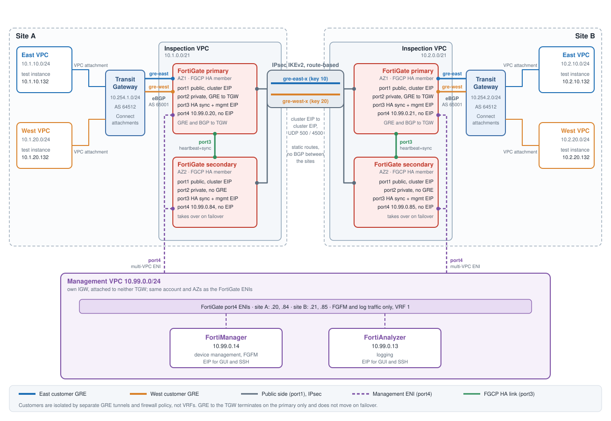

This documentation describes the **demo-ha-env** demo: a Terraform-built design in which two customers (**east** and **west**)
share one pair of FortiGates at each of two sites, yet their traffic stays separate end to end. Each customer has its own
GRE tunnel to the Transit Gateway and its own GRE tunnel, carried inside an IPsec tunnel, to the other site.

Each customer also has its own **VRF** on the FortiGate. The documentation records how that was built, the failure that was found on the way, and the one setting (`skip-vrf-match`) that fixes it. See [VRF Isolation](6_vrf_isolation/).
