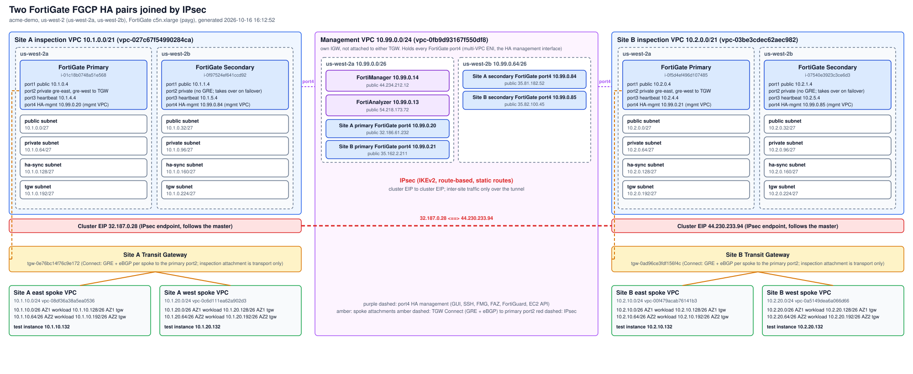

# Network diagram

Generated 2026-10-16 16:12:52 from terraform state (acme-demo, us-west-2).

FortiGate image: `FortiGate-VM64-AWSONDEMAND build0245 (8.0.1) GA-3124a694-441c-4ff1-8bf7-4d153be424a6`

## VPCs

| VPC | CIDR | VPC ID |
|---|---|---|
| Management | 10.99.0.0/24 | vpc-0fb9d93167f550df8 |
| Site A inspection | 10.1.0.0/21 | vpc-027c67f54990284ca |
| Site A east spoke | 10.1.10.0/24 | vpc-08df36a38a5ea0536 |
| Site A west spoke | 10.1.20.0/24 | vpc-0c6d111ea62a902d3 |
| Site B inspection | 10.2.0.0/21 | vpc-03be3cdec62aec982 |
| Site B east spoke | 10.2.10.0/24 | vpc-00f479acab76141b3 |
| Site B west spoke | 10.2.20.0/24 | vpc-0a5149dea6a066d66 |

## Inspection VPC subnets (/27)

| Subnet | Site A AZ1 (us-west-2a) | Site A AZ2 (us-west-2b) | Site B AZ1 (us-west-2a) | Site B AZ2 (us-west-2b) |
|---|---|---|---|---|
| public | 10.1.0.0/27 | 10.1.0.32/27 | 10.2.0.0/27 | 10.2.0.32/27 |
| private | 10.1.0.64/27 | 10.1.0.96/27 | 10.2.0.64/27 | 10.2.0.96/27 |
| ha-sync | 10.1.0.128/27 | 10.1.0.160/27 | 10.2.0.128/27 | 10.2.0.160/27 |
| tgw | 10.1.0.192/27 | 10.1.0.224/27 | 10.2.0.192/27 | 10.2.0.224/27 |

## FortiGates

| Site | Role | Instance | port1 (public) | port3 (heartbeat) | port4 (HA-mgmt) | port4 public IP |
|---|---|---|---|---|---|---|
| A | Primary | i-01c18b0748a51e568 | 10.1.0.4 | 10.1.4.4 | 10.99.0.20 | 32.186.61.232 |
| A | Secondary | i-0f97524ef641ccd92 | 10.1.1.4 | 10.1.5.4 | 10.99.0.84 | 35.81.182.52 |
| B | Primary | i-0f5d4ef496d107485 | 10.2.0.4 | 10.2.4.4 | 10.99.0.21 | 35.162.2.211 |
| B | Secondary | i-07540e3923c3ce6d3 | 10.2.1.4 | 10.2.5.4 | 10.99.0.85 | 35.82.100.45 |

## IPsec

| Site | Cluster EIP (tunnel endpoint) |
|---|---|
| A | 32.187.0.28 |
| B | 44.230.233.94 |

## Management VPC

| Item | Private IP | Public IP |
|---|---|---|
| FortiManager | 10.99.0.14 | 44.234.212.12 |
| FortiAnalyzer | 10.99.0.13 | 54.218.173.72 |

## TGW Connect (GRE and eBGP)

Each spoke has a Connect attachment and one Connect peer to the primary FortiGate port2. GRE does not move on HA failover.

| Spoke | FortiGate GRE interface | BGP inside CIDR | FortiGate / TGW BGP peers |
|---|---|---|---|
| east | gre-east | 169.254.6.0/29 | .1 / .2, .3 |
| west | gre-west | 169.254.7.0/29 | .1 / .2, .3 |

The FortiGate (AS 65001) advertises a default route and the remote-site prefixes to the TGW (AS 64512) and learns the local spoke prefixes.

## Transit gateways and spoke test instances

| Site | TGW | East test instance | West test instance |
|---|---|---|---|
| A | tgw-0e76bc14f76c9e172 | 10.1.10.132 | 10.1.20.132 |
| B | tgw-0ad96ce3fdf156f4c | 10.2.10.132 | 10.2.20.132 |
